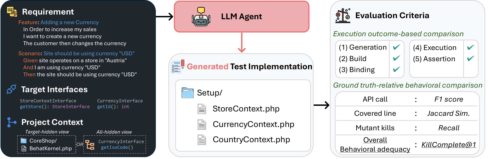

<h1 align="center">Req2Test-Bench</h1>

<p align="center"><strong>[&nbsp;<a href="https://arxiv.org/abs/2610.36584">Paper</a>&nbsp;|&nbsp;<a href="https://huggingface.co/datasets/code-philia/Req2Test-Bench">Dataset</a>&nbsp;|&nbsp;<a href="#-leaderboard">Leaderboard</a>&nbsp;|&nbsp;<a href="#-documentation">Documentation</a>&nbsp;]</strong></p>

<p align="center">
    <a href="https://www.python.org/">
        
    </a>
    <a href="LICENSE">
        
    </a>
    <a href="https://arxiv.org/abs/2610.36584">
        
    </a>
    <a href="https://huggingface.co/datasets/code-philia/Req2Test-Bench">
        
    </a>
</p>

---

Code and data for *Benchmarking LLM Agents for Behaviorally Adequate Test Generation from Software Requirements*.

## 👋 Overview

Req2Test-Bench is a benchmark for **requirement-to-test generation** in real projects. Given a *requirement* (a
Gherkin Feature with one target Scenario), its *target interfaces* and a runnable *view of the project* that hides the
target implementation, an agent writes the Scenario's executable *test implementation*. Req2Test-Bench runs that test
against the project's real code. It checks whether the test passes, and whether it fails on every *mutant* (a copy of
the code with one injected fault) that the developers' own test of the requirement catches. A test that does both is
*KillComplete*.



The `eval` split has 2,051 instances from 8 projects in Python, Java, PHP, Go, and Ruby. The metrics are Pass@1,
**KillComplete@1**, mutant-kill recall, API F1 and coverage Jaccard ([docs/metrics.md](docs/metrics.md)).

To access Req2Test-Bench, copy and run the following code:

```python
from datasets import load_dataset
req2test = load_dataset("code-philia/Req2Test-Bench", split="eval")
```

## 🕹️ Set Up

Req2Test-Bench runs every test in rootless Docker on Linux x86_64. Your agent works in a workspace where it can run
the project's code, and these workspaces need bubblewrap. The full list of requirements is in
[docs/environments.md](docs/environments.md#prerequisites).

Install the `req2test` command-line tool from a git clone and fetch one project:

```sh
git clone https://github.com/code-philia/Req2Test-Bench.git && cd Req2Test-Bench
python3 -m venv .venv && . .venv/bin/activate
python3 -m pip install -e .
req2test fetch --split eval --project python-docx      # dataset, evaluation kit, source views and runtime pack
```

Test your installation by running:

```sh
req2test validate --project python-docx --sample 20
mkdir -p ~/r2t-work/ws && req2test runtime preflight --project python-docx --workspace-root ~/r2t-work/ws
```

The first command scores the developers' own tests of 20 instances and should print "OK, within single-observation
noise". The second checks that the workspaces under `~/r2t-work/ws` can run the project's tools on this host.

> [!NOTE]
> Keep tasks, workspaces and predictions outside the clone, for example in `~/r2t-work`. `req2test` refuses a clone
> with untracked files.

## 🚀 Usage

### 1. Prepare the tasks

Export one task per instance. A task holds the requirement, the target interfaces, where the test goes, and facts
about the project that the workspace does not show ([docs/agents.md](docs/agents.md)):

```sh
req2test tasks --split eval --project python-docx --out ~/r2t-work/tasks.jsonl
```

### 2. Run your agent

Your agent works on each task in its own workspace: a copy of the project with the target code hidden, where it can
build and run the code. It writes the test there. The task's prediction holds the files it wrote, with paths relative
to the project's root:

```json
{"instance_id": "python-docx/features/api-open-document.feature:13", "model_name_or_path": "my-system",
 "view": "th", "files": [{"path": "features/steps/api.py", "content": "..."}]}
```

`req2test.inference.run_agent` does this for a command-line agent. For each task, it prepares the workspace, runs the
agent there in a sandbox that can reach only the model provider, and writes the prediction. The agent reads its prompt
on standard input. The prompt is made from the task by [req2test/inference/prompt.py](req2test/inference/prompt.py),
the same prompt that the leaderboard's runs used when their agent could run the project's code (the rows without †).

**Example - Codex CLI:** This runs Codex with
DeepSeek-V4.1-Flash at high reasoning effort, as in the leaderboard's first row, on the first three tasks:

```sh
export DEEPSEEK_API_KEY=<your key>
python3 -m req2test.inference.run_agent --agent codex --model deepseek/deepseek-flash \
  --tasks ~/r2t-work/tasks.jsonl --limit 3 -o ~/r2t-work/codex-deepseek
```

It writes `~/r2t-work/codex-deepseek/predictions.jsonl`.

**Your own agent.** `run_agent` also runs your own command-line agent. Give the command that starts it after `--`,
with `--env` for its API key and `--allow` for its provider's host. For each task, it starts the agent in the task's
workspace with the task's prompt on standard input, and collects the files the agent writes under `./repo`.
[Your own command-line agent](docs/agents.md#your-own-command-line-agent) shows a start script for an agent you
develop, and the commands for Codex, Claude Code and OpenCode.

Add `--workers 8` to run eight tasks at a time, or `--docker IMAGE` to run the agent in a Docker container
([docs/agents.md](docs/agents.md#agents-in-containers)). `python3 -m req2test.inference.run_agent --help`
lists every option. To run the steps with your own code instead of `run_agent`, for example to give your agent a
prompt of your own, see [docs/agents.md](docs/agents.md#the-flow).

### 3. Evaluate

```sh
req2test evaluate --predictions ~/r2t-work/codex-deepseek/predictions.jsonl --split eval --project python-docx \
  --run-id my-run
```

Instances without a prediction count as generation failures, so these three predictions score at most 3
of python-docx's 237 instances. The run summary is written to `~/.req2test/runs/my-run/summary.json`, with a readable
`report.md` next to it ([docs/outputs.md](docs/outputs.md)).

Other commands:

```sh
req2test evaluate --predictions FILE --run-id try1 --sample 20     # evaluate 20 instances per project
req2test report --run-id my-run                                   # re-score a run directory, no Docker
req2test env stop-daemon                                          # stop this home's rootless Docker daemon
req2test --help                                                   # all commands
```

> [!WARNING]
> Mutation scoring is resource intensive. One full configuration takes about 1,000 worker-hours. The default worker
> pools are sized for a 64-CPU host, so pass a lower `--workers` on a smaller host.

See the [evaluation guide](docs/evaluation.md) for subset runs, [runs split over several
hosts](docs/evaluation.md#split-a-run-over-hosts), the cost of each project and troubleshooting.

## ⬇️ Downloads

| Data | Where | How |
|---|---|---|
| Task rows (`eval`, `full`) and ground-truth tests (`gt_tests`) | [🤗 code-philia/Req2Test-Bench](https://huggingface.co/datasets/code-philia/Req2Test-Bench) | `load_dataset` ([docs/dataset.md](docs/dataset.md)) |
| Evaluation kits, source views and runtime packs (7.2 GB) | the same repository, `releases/<tag>/` | `req2test fetch` ([docs/kits.md](docs/kits.md)) |

For a host without Internet access, see [docs/kits.md](docs/kits.md#hosts-without-internet-access).

## 🏆 Leaderboard

Equal-weight means over the eight projects, `eval` split, target-hidden view, in percent. Every cell is in
[results/leaderboard.json](results/leaderboard.json). A run is comparable with this table when the agent follows the
[generation protocol](docs/agents.md#the-generation-protocol) on the whole `eval` split.

<!-- leaderboard:start (generated by scripts/build_leaderboard.py; do not edit) -->
| System | Model | Reasoning | Pass@1 | KillComplete@1 | API F1 | Coverage J | Mutation R |
|---|---|---|---:|---:|---:|---:|---:|
| Codex CLI‡ | DeepSeek-V4.1-Flash | high | 93.2 | 36.4 | 71.0 | 85.3 | 85.9 |
| Codex CLI | GPT-6.1 Sol | high | 87.2 | 35.5 | 64.9 | 77.6 | 79.4 |
| Codex CLI† | DeepSeek-V4.1-Flash | high | 82.8 | 33.8 | 64.2 | 75.9 | 76.3 |
| Claude Code† | Claude Sonnet 5.5 | high | 80.9 | 35.9 | 61.7 | 76.0 | 75.6 |
| Claude Code† | DeepSeek-V4.1-Flash | high | 80.5 | 34.4 | 62.0 | 73.2 | 73.3 |
| Codex CLI† | GPT-6 Sol | high | 73.5 | 31.3 | 54.2 | 65.3 | 66.1 |
| Codex CLI† | GPT-6 Luna | high | 66.2 | 28.3 | 49.9 | 59.6 | 60.6 |
| Codex CLI† | DeepSeek-V4.1-Flash | off | 57.6 | 23.6 | 41.9 | 53.1 | 53.4 |
| OpenHands† | DeepSeek-V4.1-Flash | off | 32.7 | 18.1 | 26.4 | 30.9 | 31.2 |
| Aider† | DeepSeek-V4.1-Flash | off | 9.7 | 4.5 | 6.6 | 8.0 | 8.5 |

† Results reported in the [paper](https://arxiv.org/abs/2610.36584), on the 2,051 eval instances, generated without the runtime packs, so the agent could not run the application.

‡ Algorand SDK, Kapua and 135 PrestaShop instances ran on DeepSeek's 17 October 2026 update of DeepSeek-V4.1-Flash.
<!-- leaderboard:end -->

## 📖 Documentation

| Topic | Document |
|---|---|
| Dataset splits, fields and counts | [docs/dataset.md](docs/dataset.md) |
| Running your own agent: tasks, workspaces, runtime packs, the generation protocol | [docs/agents.md](docs/agents.md) |
| Predictions, `evaluate`, `validate`, runs over several hosts, cost, troubleshooting | [docs/evaluation.md](docs/evaluation.md) |
| Metrics and scoring rules | [docs/metrics.md](docs/metrics.md) |
| Run outputs: `summary.json`, `report.md`, `instances.jsonl`, `validate.json` | [docs/outputs.md](docs/outputs.md) |
| Target-hidden source views | [docs/views.md](docs/views.md) |
| Host requirements, rootless Docker and worker pools | [docs/environments.md](docs/environments.md) |
| Evaluation kits, releases, `fetch` and offline hosts | [docs/kits.md](docs/kits.md) |
| The evaluation engine and its self-tests | [docs/engine.md](docs/engine.md) |


## 📝 Citation

If you find our work helpful, please use the following citation:

```bibtex
@misc{req2testbench2026,
  title         = {Benchmarking {LLM} Agents for Behaviorally Adequate Test Generation from Software Requirements},
  author        = {Qi, Binhang and Liu, Yiming and Lin, Yun and Zhou, Yangjie and Sun, Hailong and Dong, Jin Song},
  year          = {2026},
  eprint        = {2610.36584},
  archivePrefix = {arXiv},
  primaryClass  = {cs.SE}
}
```
